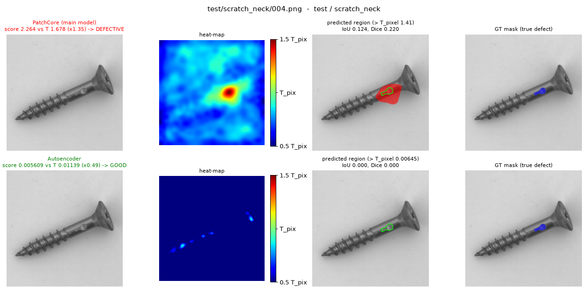
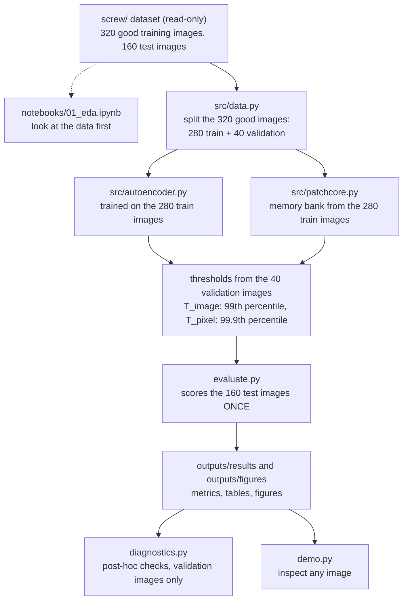

# Anomaly detection on MVTec AD screws: autoencoder vs PatchCore

**Team:** Shayan Dorriz, Sanket Ganesh Gaikwad, Antoine Hervé Marie Jeanselme

**Course:** Machine Learning for Mechanical Systems, Politecnico di Milano, 2026–27, Prof. Loris Roveda (Project 3)

We built a system that looks at a photo of a screw, decides whether the screw is good or defective, and shows where the defect is, while training only on photos of good screws. We compared two methods: a convolutional autoencoder that we trained from scratch on our 280 training images, and PatchCore, which compares small image patches with a memory of features from a network pretrained on ImageNet. PatchCore is clearly better: on the 160 test images it reaches an AUROC of 0.947 against 0.752, and it catches 89 of the 119 defective screws while wrongly rejecting 1 of the 41 good ones, where the autoencoder catches only 4.



*Output of `python demo.py screw/test/scratch_neck/004.png`. Top row, PatchCore: the score is 1.35 × its threshold, so the screw is called DEFECTIVE, and the predicted region (red) covers the scratch (green outline). Bottom row, autoencoder: the score is 0.49 × its threshold, so the screw is called GOOD and the defect is missed. Columns: input image, heat-map, predicted region, true defect mask.*

## Contents

1. [The problem in plain words](#1-the-problem-in-plain-words)
2. [Results](#2-results)
3. [How it works](#3-how-it-works)
4. [Concepts you need](#4-concepts-you-need)
5. [Map of the repository](#5-map-of-the-repository)
6. [Setup on Windows](#6-setup-on-windows)
7. [How to run](#7-how-to-run)
8. [What each output file means](#8-what-each-output-file-means)
9. [Rules we followed](#9-rules-we-followed)
10. [Troubleshooting](#10-troubleshooting)
11. [Licence, citations and credits](#11-licence-citations-and-credits)

## 1. The problem in plain words

**Anomaly detection.** A factory wants a camera to check every screw. Defects are rare and come in many forms, so it is hard to collect many examples of each one. Instead, we show the model only good screws. It learns what "normal" looks like and gives every new image an **anomaly score**: the higher the score, the less the image looks like the good screws it has seen. A **threshold** turns the score into a decision (good or defective), and a **heat-map** shows where the image looks abnormal. Learning from one class only (good screws) is called **one-class** or **semi-supervised** anomaly detection.

**The dataset.** We use the screw category of [MVTec AD](https://www.mvtec.com/research-teaching/datasets/mvtec-ad), a public benchmark of industrial images. It is included in this repository, in the `screw/` folder.

| Folder | Images | How we use them |
|---|---|---|
| `screw/train/good` | 320 good | split once into **280 training** and **40 validation** images (fixed seed, saved in `outputs/results/split.json`) |
| `screw/test/good` | 41 good | final test only |
| `screw/test/manipulated_front` | 24 defective | final test only |
| `screw/test/scratch_head` | 24 defective | final test only |
| `screw/test/scratch_neck` | 25 defective | final test only |
| `screw/test/thread_side` | 23 defective | final test only |
| `screw/test/thread_top` | 23 defective | final test only |
| `screw/ground_truth/<type>` | 119 masks | white pixels mark the defect; used only to score localisation |

The test set therefore has 160 images: 41 good and 119 defective.

What makes screws hard (from our data exploration in `notebooks/01_eda.ipynb`):

- The images are 1024 × 1024 pixels, greyscale. Both models work on copies resized to 256 × 256.
- Screws lie at any angle and position, so even "normal" varies a lot ([eda_01_good_samples.png](outputs/figures/eda_01_good_samples.png)).
- Defects are tiny. The median defect covers 0.29% of the image, and 118 of the 119 cover less than 1%. At 256 × 256 a typical defect is about 190 pixels, roughly a 14 × 14 square ([eda_03_defect_area.png](outputs/figures/eda_03_defect_area.png), [eda_04_defect_pixels_vs_size.png](outputs/figures/eda_04_defect_pixels_vs_size.png)).
- The background has dust specks and small marks that can look like defects.
- The good test images are darker than all the others: mean grey value 0.67, against 0.72 for the training images and 0.73 for the defective test images, on a scale from 0 (black) to 1 (white) ([eda_05_brightness.png](outputs/figures/eda_05_brightness.png)).

**The questions.** The project handout asks:

> Can a model trained primarily on normal industrial images detect and localize previously unseen visual defects?

and, as the mandatory comparison:

> Do pretrained visual representations provide more reliable industrial defect detection and localization than reconstruction-based models trained only on the target dataset?

To answer, we compare a **reconstruction-based model** (a convolutional autoencoder trained only on our 280 good training screws) with a **pretrained representation** (PatchCore, built on a wide_resnet50_2 network pretrained on ImageNet, a collection of 1.2 million everyday photos, with no training on screws). Our answers are in [section 2.4](#24-our-answers).

## 2. Results

All numbers in this section come from the files in [`outputs/results/`](outputs/results), written by **one** run of `evaluate.py` on the 160 test images. The thresholds were computed from the 40 good validation images and saved before any test image was loaded ([section 9](#9-rules-we-followed)).

We evaluated four variants:

| Variant | Model | Brightness normalisation |
|---|---|---|
| `ae_raw` | autoencoder | off |
| `ae_bn` | autoencoder | on |
| `pc_raw` | PatchCore (our main model) | off |
| `pc_bn` | PatchCore | on |

**Brightness normalisation** shifts every image so that its mean grey value is 0.72 (the training average) before the model sees it. We added it as an option after the data exploration showed that the good test images are darker. It is off by default, and we report both versions instead of choosing one with test results. `pc_raw` is our main model because it uses the default settings.

### 2.1 Main table

| variant | AUROC | precision | recall | F1 | false-reject rate | TP | FN | FP | TN | pixel AUROC | IoU | Dice |
|---|---|---|---|---|---|---|---|---|---|---|---|---|
| ae_raw | 0.752 | 1.000 | 0.034 | 0.065 | 0.000 | 4 | 115 | 0 | 41 | 0.969 | 0.040 | 0.062 |
| ae_bn | 0.708 | 1.000 | 0.050 | 0.096 | 0.000 | 6 | 113 | 0 | 41 | 0.970 | 0.032 | 0.050 |
| **pc_raw** | **0.947** | 0.989 | 0.748 | 0.852 | 0.024 | 89 | 30 | 1 | 40 | 0.990 | 0.141 | 0.235 |
| pc_bn | 0.944 | 0.978 | 0.756 | 0.853 | 0.049 | 90 | 29 | 2 | 39 | 0.990 | 0.132 | 0.224 |

How to read it (a "positive" is a defective screw; full explanations in [section 4](#4-concepts-you-need)):

- **AUROC**: how well the scores separate defective from good screws, over all possible thresholds (1 = perfect, 0.5 = guessing). Our main image-level number.
- **TP / FN**: defective screws caught / missed. **FP / TN**: good screws wrongly rejected / correctly accepted.
- **Precision** = TP / (TP + FP). **Recall** = TP / (TP + FN). **F1** combines the two. **False-reject rate** = FP / 41, the share of good screws thrown away.
- **Pixel AUROC, IoU, Dice**: how well the heat-map and the predicted region match the true defect masks.

The thresholds ([thresholds.csv](outputs/results/thresholds.csv)):

| variant | T_image | T_pixel | 40 validation scores: min / median / max |
|---|---|---|---|
| ae_raw | 0.01139 | 0.006448 | 0.00413 / 0.006196 / 0.01192 |
| ae_bn | 0.01045 | 0.005679 | 0.003965 / 0.005762 / 0.01111 |
| pc_raw | 1.678 | 1.410 | 1.256 / 1.428 / 1.685 |
| pc_bn | 1.649 | 1.400 | 1.263 / 1.429 / 1.699 |

The two models' scores are on different scales (squared pixel error for the autoencoder, distance between features for PatchCore), so compare AUROC and decisions, not raw scores. Because T_image is the 99th percentile of 40 scores, exactly one validation image of each variant lies above it.

### 2.2 Results per defect type

Recall: the share of defective screws caught at T_image (with the count).

| defect type (n) | ae_raw | ae_bn | pc_raw | pc_bn |
|---|---|---|---|---|
| manipulated_front (24) | 0.042 (1/24) | 0.042 (1/24) | 0.583 (14/24) | 0.625 (15/24) |
| scratch_head (24) | 0.000 (0/24) | 0.000 (0/24) | 0.667 (16/24) | 0.708 (17/24) |
| scratch_neck (25) | 0.040 (1/25) | 0.080 (2/25) | 1.000 (25/25) | 0.960 (24/25) |
| thread_side (23) | 0.043 (1/23) | 0.043 (1/23) | 0.565 (13/23) | 0.565 (13/23) |
| thread_top (23) | 0.043 (1/23) | 0.087 (2/23) | 0.913 (21/23) | 0.913 (21/23) |

AUROC of each defect type against the 41 good test screws:

| defect type (n) | ae_raw | ae_bn | pc_raw | pc_bn |
|---|---|---|---|---|
| manipulated_front (24) | 0.682 | 0.592 | 0.888 | 0.893 |
| scratch_head (24) | 0.769 | 0.723 | 0.965 | 0.948 |
| scratch_neck (25) | 0.675 | 0.641 | 0.998 | 0.996 |
| thread_side (23) | 0.762 | 0.717 | 0.885 | 0.898 |
| thread_top (23) | 0.878 | 0.875 | 0.994 | 0.982 |

IoU and Dice per defect type are in [per_defect.csv](outputs/results/per_defect.csv).

### 2.3 Key findings

**1. PatchCore clearly beats the autoencoder.**

- PatchCore separates the two classes far better: AUROC 0.947 against 0.752 (ROC curves in [eval_roc.png](outputs/figures/eval_roc.png)). With the same threshold rule, it catches 89 of the 119 defective screws; the autoencoder catches 4.
- In [eval_score_hist.png](outputs/figures/eval_score_hist.png), most of PatchCore's defective scores lie above its threshold. The autoencoder's defective scores are only slightly higher than its good ones, and almost all of them stay below its threshold.
- Why the autoencoder fails: its reconstructions are blurry. Even on good screws it cannot rebuild the fine thread and the edges of the head, so the error there is high in every image ([ae_val_reconstructions.png](outputs/figures/ae_val_reconstructions.png)). A tiny defect adds little on top of this normal error and is drowned out.
- Even its few detections are mostly not caused by the defect. Of the 4 screws that `ae_raw` flags, 2 have their highest error in an image corner and 1 on the smooth shaft away from the defect; only 1 peaks near the real defect ([eval_examples_ae_raw.png](outputs/figures/eval_examples_ae_raw.png)).
- Defect types: PatchCore catches every scratch on the neck (25/25) and almost every thread_top defect (21/23), but only about 6 in 10 thread_side (13/23) and manipulated_front (14/24) defects. Our interpretation: the neck is smooth, so any mark stands out, while the thread and the tip already look different from one good screw to the next.
- The industrial trade-off: with our threshold, PatchCore wrongly rejects 1 of the 41 good screws and lets 30 of the 119 defective screws through. A lower threshold would catch more defects but throw away more good screws; the histogram shows where the two groups overlap. We fixed the threshold rule before testing and did not move it afterwards.

**2. The brightness shift raised the autoencoder's AUROC; PatchCore did not care.**

- We expected the darker good test images to cause false alarms. They did not: the autoencoder has no false alarm at all, and PatchCore's single false alarm has another cause (finding 3).
- Instead, the darker good test images got *lower* autoencoder scores than the validation images (median 0.0052 against 0.0062), while the defective images scored 0.0066. So part of the autoencoder's AUROC comes from the light level, not from the defects: with brightness normalisation its AUROC drops from 0.752 to 0.708. In the robustness test, shifting all images by ±0.05 moves `ae_raw`'s AUROC between 0.706 and 0.826, while `ae_bn` stays at 0.707.
- Brightness is not the whole story: even with normalisation, the good test screws score lower than the validation screws (median 0.0048 against 0.0058). We did not investigate this further.
- PatchCore is not affected: AUROC 0.947 without and 0.944 with normalisation, and between 0.941 and 0.951 under ±0.05 brightness. Normalisation did not help it either (2 false alarms instead of 1).

**3. Dust specks and background marks fool PatchCore.**

- PatchCore's only false alarm, `test/good/005.png` (score 1.04 × T), comes from a thin dark mark on the background next to the screw ([demo_good_005.png](outputs/figures/demo_good_005.png)).
- Some detections are right for the wrong reason. `test/thread_side/000.png` is correctly called defective, but the predicted region is a group of dust specks on the background, far from the real defect (IoU 0) ([demo_thread_side_000.png](outputs/figures/demo_thread_side_000.png)). In [eval_examples_pc_raw.png](outputs/figures/eval_examples_pc_raw.png), `scratch_head/012` is flagged on the head but also on two spots of background.
- For PatchCore, a mark on the background is as unusual as a mark on the screw. Ignoring the background (for example with a mask of the screw) might help, but we did not try it: it would mean changing the method after seeing the test results.

**4. Finding a defect is easier than outlining it.**

- Pixel AUROC is high for both models (0.990 PatchCore, 0.969 autoencoder), but IoU and Dice are low (PatchCore 0.141 / 0.235, autoencoder 0.040 / 0.062).
- Pixel AUROC is computed over all pixels, and almost all of them are background or normal screw far from any defect, which are easy to call normal. IoU and Dice only compare the predicted region with the true defect, so they show the real localisation quality.
- PatchCore's regions are coarse blobs. It scores a 32 × 32 grid of patches (each cell is 8 × 8 pixels of the 256 px image, and its features see an even larger area), and we smooth the map. Its predicted regions contain 87% of the defect pixels (pixel recall 0.870), but only 11% of the predicted pixels are really defective (pixel precision 0.113). In the figure at the top, the red blob covers the scratch but is much larger.
- Size helps but does not decide alone: the smallest defect in the test set (`scratch_neck/022.png`, 0.10% of the image) is caught, while some thread_side defects larger than 0.5% are missed ([eval_score_vs_area.png](outputs/figures/eval_score_vs_area.png)).

**5. Robustness: PatchCore's threshold has little margin.**

The frozen robustness test (part of the one `evaluate.py` run) changed all validation and test images in six ways: brightness −0.05 and +0.05, contrast × 0.8 and × 1.2 (around each image's mean), a 10° rotation (the empty corners filled with the image's median grey), and Gaussian noise with σ = 0.02. Test AUROC, and false-reject rate (FRR) on the 41 good test screws ([robustness.csv](outputs/results/robustness.csv)):

| perturbation | AUROC ae_raw | AUROC ae_bn | AUROC pc_raw | AUROC pc_bn | FRR ae_raw | FRR ae_bn | FRR pc_raw | FRR pc_bn |
|---|---|---|---|---|---|---|---|---|
| none (clean) | 0.752 | 0.708 | 0.947 | 0.944 | 0.000 | 0.000 | 0.024 | 0.049 |
| brightness −0.05 | 0.706 | 0.707 | 0.941 | 0.944 | 0.049 | 0.000 | 0.024 | 0.049 |
| brightness +0.05 | 0.826 | 0.707 | 0.951 | 0.944 | 0.000 | 0.000 | 0.024 | 0.049 |
| contrast × 0.8 | 0.789 | 0.668 | 0.943 | 0.932 | 0.000 | 0.000 | 0.024 | 0.122 |
| contrast × 1.2 | 0.734 | 0.724 | 0.928 | 0.962 | 0.073 | 0.024 | 0.171 | 0.098 |
| rotation 10° | 0.725 | 0.656 | 0.725 | 0.668 | 0.000 | 0.000 | 1.000 | 1.000 |
| noise σ 0.02 | 0.752 | 0.714 | 0.804 | 0.801 | 0.000 | 0.000 | 1.000 | 1.000 |

- Brightness and contrast barely change PatchCore's AUROC (between 0.928 and 0.962), but its threshold reacts: with higher contrast, `pc_raw` rejects 7 of the 41 good screws instead of 1.
- After a 10° rotation or added noise, PatchCore rejects **every** good screw, and its AUROC drops to 0.725 (rotation) and 0.804 (noise).
- The autoencoder's scores follow the image contrast: on the validation images they fall by 32% with lower contrast and rise by 42% with higher contrast, against +1.9% and +5.5% for PatchCore.
- `ae_raw` and `pc_raw` have exactly the same rotation AUROC (0.725). This is a coincidence: both models rank 3,537 of the 4,879 (good, defective) pairs correctly. We checked that their scores are different.

**Post-hoc diagnostics.** After the test we asked why rotation and noise break PatchCore. [`diagnostics.py`](diagnostics.py) uses only the 40 validation images, with the frozen models and thresholds, so it explains the frozen numbers but does not replace them ([diagnostics.csv](outputs/results/diagnostics.csv), [diag_summary.png](outputs/figures/diag_summary.png), [diag_examples.png](outputs/figures/diag_examples.png)).

| condition | what was done to the 40 good validation images | pc_raw: images above T | pc_raw: mean score change | ae_raw: mean score change |
|---|---|---|---|---|
| clean | nothing | 1 / 40 | 0% | 0% |
| rotate_10_256 | the frozen test: 10° rotation at 256 px, corners filled with flat grey | 40 / 40 | +72.3% | −15.6% |
| wedges_only | no rotation, only the flat grey corners pasted in | 40 / 40 | +68.6% | +0.4% |
| rot10_reflect_256 | 10° rotation at 256 px, corners filled by mirroring (no flat grey) | 13 / 40 | +15.0% | −19.6% |
| rot10_reflect_1024 | 10° rotation at the full 1024 px with mirrored corners, then resized | 8 / 40 | +8.9% | −3.6% |
| rot90 | exact 90° rotation (no blur, no flat corners) | 39 / 40 | +31.7% | −0.8% |
| noise_256 | the frozen test: noise σ 0.02 added after resizing | 40 / 40 | +41.9% | +5.5% |
| noise_1024 | the same noise added at 1024 px before resizing, like real camera noise | 1 / 40 | +0.1% | 0.0% |
| clean_via_1024 | check: the 1024 px route without any change | 1 / 40 | 0% | 0% |

What we learned:

- The rotation drop comes mostly from the flat grey corners, not from the angle: pasting only the grey corners, without rotating, has almost the same effect (+68.6% against +72.3%). Without flat corners, rotating the small 256 px image still blurs it (+15.0%), and a clean rotation at full resolution gives +8.9%.
- Noise added at 1024 px before resizing, like real camera noise, changes nothing (+0.1%), because resizing averages it away. Added after resizing, as in the frozen test, it creates a pixel-level texture that no real photo has.
- So the frozen test exaggerates the problem, but the problem is real: even a clean 10° rotation pushes 8 of the 40 good validation screws (20%) above T. PatchCore's threshold has little margin. It comes from only 40 images, and T (1.678) sits just below the highest validation score (1.685), with the median at 1.428. A new camera, new lighting or a new background would need new good validation images and a new threshold (recalibration).
- An exact 90° rotation (no blur, no flat corners) still raises PatchCore's scores by 31.7%. The training screws lie at all angles, so the angle of the screw is not the cause. Our hypothesis, which we did not test: the lighting and the background have a fixed direction in all photos, and rotating the whole image rotates them too, which PatchCore has never seen.
- The autoencoder's scores change less and mostly go down under rotation, so it never rejects more than 2 of the 40 validation screws. Since it detects few defects in the first place, this is not a real strength.

### 2.4 Our answers

- **Can a model trained only on good images detect and localise unseen defects?** Partly. PatchCore detects 3 out of 4 defective screws while rejecting 1 of 41 good ones, but its defect regions are coarse (IoU 0.141), and its decisions are only reliable while new images look like the training images.
- **Do pretrained representations give more reliable detection and localisation than a reconstruction model trained only on our screws?** On this dataset, yes, clearly. PatchCore detects better (AUROC 0.947 against 0.752; recall 0.748 against 0.034 with the same threshold rule) and localises better (Dice 0.235 against 0.062; IoU 0.141 against 0.040). Part of the autoencoder's AUROC is explained by the brightness difference of the test images, not by the defects. PatchCore's weak points are background marks, coarse regions and a threshold that needs recalibration when the imaging conditions change.

## 3. How it works



1. **Dataset** (`screw/`). The original MVTec AD screw images and masks. No script ever writes into this folder.
2. **Look at the data first** (`notebooks/01_eda.ipynb`). Counts, examples of every defect type with its mask, defect sizes and brightness. Looking at test images is allowed here because nothing is chosen from them. This is where we found the tiny defect sizes and the darker good test images.
3. **Split and loading** (`src/data.py`). The 320 good training images are shuffled once with seed 42 and split into 280 for training and 40 for validation; the lists are saved in `split.json`, so every script uses exactly the same images. Every image is loaded as greyscale, resized to 256 × 256 and scaled to values between 0 and 1. Masks are resized with nearest-neighbour, so they stay purely black and white.
4. **Model 1, autoencoder** (`src/autoencoder.py`). Trained for 120 epochs on the 280 images, with random rotations and flips because screws lie at any angle. The 40 validation images are only used to keep the weights of the epoch with the lowest validation loss. The heat-map is the smoothed squared error between the image and its reconstruction; the score is its maximum.
5. **Model 2, PatchCore** (`src/patchcore.py`). No training. A frozen network pretrained on ImageNet turns each of the 280 images into a 32 × 32 grid of patch features, and 10% of all these features are kept as the memory bank. The score of a new image is the largest distance between one of its patches and the nearest patch in the bank.
6. **Thresholds.** Each model scores the 40 validation images. T_image is the 99th percentile of the 40 scores; T_pixel is the 99.9th percentile of all their heat-map pixels. Both are saved in `thresholds.csv` before any test image is loaded.
7. **One-time test** (`evaluate.py`). Phase A uses validation images only and fixes the thresholds. Phase B is the only place where the 160 test images are scored, with and without the robustness perturbations. Phase C computes all metrics and figures from the saved files. A second normal run refuses to start.
8. **Diagnostics** (`diagnostics.py`). After the test, extra robustness checks on the 40 validation images only.
9. **Demo** (`demo.py`). For any image: score, decision, heat-map, predicted region and, for test images, the true mask, using the frozen models and thresholds.

## 4. Concepts you need

**One-class (semi-supervised) anomaly detection.** The model learns only from normal examples, here good screws, and flags whatever looks different. This fits factories well: good parts are easy to collect, while defects are rare and can take forms nobody has seen before. It is called semi-supervised because one piece of label information is still used: we know that all training images are good. *Learn more:* our lecture slides `02_Anomaly_Detection`; the [MVTec AD paper](https://www.mvtec.com/fileadmin/Redaktion/mvtec.com/05_research_teaching/datasets/mvtec_ad.pdf).

**Autoencoder and reconstruction error.** An autoencoder is a neural network made of two halves. The encoder compresses the image into a small code (the bottleneck); the decoder rebuilds the image from that code. Ours squeezes a 256 × 256 image (65,536 pixels) into 32 × 8 × 8 = 2,048 numbers, so it cannot simply copy its input and has to learn what screws usually look like. Trained only on good screws, it should rebuild a defect badly. The reconstruction error, the squared difference between input and output at every pixel, is the heat-map. *Learn more:* lecture slides `02_Anomaly_Detection`.

**Pretrained CNN features and feature maps.** A convolutional neural network (CNN) trained on ImageNet (1.2 million photos of 1,000 kinds of objects) has learned general visual building blocks: edges, corners, textures, shapes. If you stop the network after one of its inner layers, it outputs a **feature map**: a grid in which each cell holds a vector of numbers (a feature) describing one region of the image. We use wide_resnet50_2, a wider version of the 50-layer ResNet, exactly as it is (frozen, no training on screws). From a 256 × 256 image we take a 32 × 32 grid of features with 1,536 numbers each. *Learn more:* [PatchCore paper](https://arxiv.org/abs/2106.08265), section 3.

**PatchCore: memory bank, nearest-neighbour distance, coreset.**

- The **memory bank** stores the patch features of all good training screws (280 images × 1,024 patches = 286,720 features). It is the model's memory of what good patches look like.
- **Nearest-neighbour distance**: for every patch of a new image, we look for the most similar feature in the bank and measure how far it is. A patch that is far from everything in the bank was never seen on a good screw, so it is anomalous. The image score is the largest patch distance; the 32 × 32 patch distances, enlarged to 256 × 256 and smoothed, form the heat-map.
- **Coreset**: searching 286,720 features for every patch is slow, so we keep 10% of them (28,672). They are chosen greedily: we always add the feature farthest from those already kept, so the small bank still covers every kind of good patch.

*Learn more:* PatchCore paper (Roth et al., [arXiv 2106.08265](https://arxiv.org/abs/2106.08265)).

**Anomaly score, threshold and heat-map.** The anomaly score is one number per image; higher means more suspicious. The threshold T_image turns it into a decision: defective if the score is above T_image. We set T_image to the 99th percentile of the 40 validation scores, which means we accept rejecting about 1% of good screws. The heat-map gives a score to every pixel. Pixels above a second threshold, T_pixel (the 99.9th percentile of all validation heat-map pixels), form the predicted defect region. The two thresholds are separate, so a screw judged GOOD can still show small red regions in the demo. *Learn more:* lecture slides `02_Anomaly_Detection`.

**AUROC and the ROC curve.** For every possible threshold, the ROC curve plots the share of defective screws caught (true positive rate) against the share of good screws wrongly rejected (false positive rate). AUROC is the area under this curve: 1 means perfect separation, 0.5 means guessing. Another way to read it: the probability that a randomly chosen defective screw scores higher than a randomly chosen good one. AUROC does not depend on the chosen threshold, which makes it good for comparing models; all the other image metrics do depend on T. *Learn more:* lecture slides `02_Anomaly_Detection`.

**Precision, recall, F1 and the confusion matrix.** The confusion matrix counts the four possible outcomes: TP (defective, caught), FN (defective, missed), FP (good, wrongly rejected) and TN (good, accepted). Precision = TP / (TP + FP): when we say "defective", how often are we right? Recall = TP / (TP + FN): which share of the defective screws do we catch? F1 = 2 × precision × recall / (precision + recall), a single number that is high only when both are high. In a factory, an FP is a good screw thrown away and an FN is a defective screw shipped to a customer. *Learn more:* lecture slides `02_Anomaly_Detection`.

**Pixel AUROC, IoU and Dice.** These measure localisation. Pixel AUROC is AUROC computed on single pixels (defect pixel or not) using the heat-map; to save memory we use a fixed random sample of 2 million of the 10.5 million test pixels. IoU (intersection over union) is the overlap between the predicted region and the true mask, divided by the area of their union. Dice is 2 × overlap / (area of the predicted region + area of the true mask). Both are 1 for a perfect match and 0 for no overlap; we average them over the 119 defective images. *Learn more:* lecture slides `02_Anomaly_Detection`.

**Training, validation and test sets; data leakage.** The training set is what the model learns from (our 280 good images). The validation set is used to make choices: here only the thresholds and the autoencoder's best epoch (40 good images the models never trained on). The test set is used once, at the end, to measure performance (160 images). Data leakage happens when information from the test set influences a choice, for example picking the threshold that gives the best test F1. The results then look better than they would on new screws. [Section 9](#9-rules-we-followed) lists how we avoided it. *Learn more:* lecture slides `02_Anomaly_Detection`.

**Distribution shift and robustness.** A distribution shift happens when new images differ systematically from the training images: other lighting, another camera, a rotated setup, more noise. Robustness is how little the scores and decisions change under such shifts. We test it by changing the images on purpose (brightness, contrast, rotation, noise) and measuring the effect. *Learn more:* the robustness section of the project handout; [MVTec AD 2](https://www.mvtec.com/research-teaching/datasets/mvtec-ad-2), a newer dataset built to study unseen lighting conditions.

## 5. Map of the repository

```text
Machine-Learning/
├── README.md              this guide
├── decisions.md           design decisions, written down before testing
├── requirements.txt       package versions (PyTorch is installed separately)
├── .gitignore             files git must never upload
├── check_env.py           checks your setup
├── evaluate.py            the one-time test on the 160 test images (+ safe re-runs)
├── diagnostics.py         post-hoc robustness checks, validation images only
├── demo.py                inspect any image with the frozen models
├── src/                   code shared by all scripts
│   ├── __init__.py
│   ├── paths.py
│   ├── data.py
│   ├── metrics.py
│   ├── autoencoder.py
│   └── patchcore.py
├── notebooks/
│   └── 01_eda.ipynb       data exploration
├── outputs/
│   ├── figures/           all figures (in git)
│   ├── results/           all tables and logs (in git)
│   ├── checkpoints/       models and test heat-maps (NOT in git: download the Release)
│   └── rerun.../          your own re-runs (NOT in git)
└── screw/                 the dataset (read-only)
```

| Path | What it does, and why | Reads | Writes |
|---|---|---|---|
| `README.md` | This guide. | | |
| `decisions.md` | Every design decision, written down before the test set was scored, plus the post-hoc findings. Shows that nothing was tuned on test images. | | |
| `requirements.txt` | Exact versions of all packages except PyTorch, so everyone gets the same results. | | |
| `.gitignore` | Files git must never upload: `.venv/`, `outputs/checkpoints/`, `outputs/rerun*/`, `*.zip`, Python caches. | | |
| `check_env.py` | Checks Python, PyTorch, the GPU and the dataset, and downloads the pretrained network once. Run it after the setup. | `screw/train/good/000.png` | nothing in the project (the network, about 130 MB, goes to the PyTorch cache in your user folder) |
| `src/__init__.py` | Empty file that makes `src` a Python package, so `from src.data import ...` works. | | |
| `src/paths.py` | All folder paths in one place, found from the file's own location, so the code runs on any computer and with spaces in folder names. | | creates `outputs/figures`, `outputs/results` and `outputs/checkpoints` if missing |
| `src/data.py` | The train/validation split; loading images (greyscale, 256 × 256, values 0 to 1) and masks (nearest-neighbour); optional brightness normalisation; conversion to PyTorch tensors. Used by every other file. | `screw/`, `outputs/results/split.json` | `split.json`, only if it does not exist (it is in git) |
| `src/metrics.py` | Thresholds from validation, image metrics, pixel metrics, per-defect tables, ROC plots. The same code for both models, for a fair comparison. | | only its self-test (`python -m src.metrics`, fake numbers) writes `outputs/figures/metrics_selftest_roc.png`, which is not committed |
| `src/autoencoder.py` | Model 1. `python -m src.autoencoder` trains it, or loads it if the model file exists, and draws its training figures. | the 280 training and 40 validation images | `outputs/checkpoints/autoencoder.pt`, `outputs/results/ae_history.csv`, `outputs/figures/ae_loss_curve.png` and `ae_val_reconstructions.png` (with `--normalize-brightness`: `autoencoder_bn.pt` and the `ae_bn_*` files) |
| `src/patchcore.py` | Model 2. `python -m src.patchcore` builds the memory bank, or loads it if the file exists, and draws validation heat-maps. | the 280 training and 40 validation images | `outputs/checkpoints/patchcore_bank.pt`, `outputs/figures/pc_val_heatmaps.png` (with `--normalize-brightness`: `patchcore_bank_bn.pt`, `pc_bn_val_heatmaps.png`) |
| `notebooks/01_eda.ipynb` | Data exploration: counts, every defect type with its mask, defect sizes, brightness. Looks at test images but chooses nothing from them. | `screw/`, `split.json` | `outputs/figures/eda_01` to `eda_05` |
| `evaluate.py` | The one-time test: thresholds from validation (Phase A), scoring of the 160 test images and the robustness test (Phase B), metrics and figures (Phase C). `--report-only` redoes Phase C only; `--out-dir` repeats everything in a separate folder. | the 4 models, `split.json`, all images and masks | `outputs/results/` (thresholds, scores, metrics, per-defect table, robustness, log), `outputs/checkpoints/<variant>_heatmaps.npz`, `outputs/figures/eval_*.png`; with `--out-dir`, the same files inside that folder only |
| `diagnostics.py` | Post-hoc check of why rotation and noise break PatchCore. Validation images only; proves with SHA-256 hashes that the frozen results do not change. | the 4 models, `thresholds.csv`, `<variant>_val_scores.csv`, `robustness.csv`, validation images | `outputs/results/diagnostics.csv`, `diagnostics_log.txt`, `outputs/figures/diag_summary.png`, `diag_examples.png` |
| `demo.py` | For any image: score, decision, heat-map, predicted region and (test images only) the true mask, for PatchCore and the autoencoder. Never retrains, never recomputes a threshold. | `autoencoder.pt`, `patchcore_bank.pt`, `thresholds.csv`, the image | `outputs/figures/demo_<folder>_<file>.png` |
| `outputs/figures/` | All figures (section 8). In git. | | |
| `outputs/results/` | All tables and logs (section 8). In git. | | |
| `outputs/checkpoints/` | Trained models and test heat-maps, about 500 MB. Not in git: download them from the Release. | | |
| `outputs/rerun*/` | Your own re-runs with `evaluate.py --out-dir`. Not in git. | | |
| `screw/` | The dataset, with its licence and readme. Read-only: no script writes into it. | | |

## 6. Setup on Windows

This takes about 20–30 minutes, mostly downloads. You need a few GB of free disk space, mostly for PyTorch.

**Step 1. Get the code and the dataset.**

- Install Git from https://git-scm.com (default options) and VS Code from https://code.visualstudio.com. VS Code offers to install its Python and Jupyter extensions the first time you open a `.py` file or a notebook; accept.
- Clone the repository. In VS Code: `Ctrl+Shift+P` → **Git: Clone** → paste `https://github.com/Sanket-Gaikwad-Polimi/Machine-Learning` → choose a folder → **Open**. Or in a terminal:

  ```powershell
  git clone https://github.com/Sanket-Gaikwad-Polimi/Machine-Learning.git
  ```

- The download is about 200 MB, mostly the dataset. Spaces in folder names are fine.
- Open the project folder in VS Code (**File → Open Folder**) and open a terminal (**Terminal → New Terminal**). Every command in this README runs in that terminal, in the project root: the folder that contains `README.md`.

**Step 2. Install Python 3.12.10.**

- Download: https://www.python.org/ftp/python/3.12.10/python-3.12.10-amd64.exe
- In the installer, leave **"Add python.exe to PATH" unticked**, then click **Install Now**.
- Check in the terminal: `py -0` must list 3.12.
- Why exactly 3.12.10, and not 3.14? We ran and tested everything with Python 3.12.10 and the package versions below. A newer Python may install other package versions, or fail to find them, and give errors or slightly different numbers. Leaving PATH unticked avoids conflicts with other Python versions on your laptop: the `py` launcher starts exactly the version you ask for (`py -3.12`).

**Step 3. Create the project environment.** A virtual environment is a private folder (`.venv`) with its own Python and packages, so this project cannot break your other projects, and they cannot break it.

```powershell
py -3.12 -m venv .venv
.venv\Scripts\Activate.ps1
python --version
```

It must print `Python 3.12.10`, and the prompt must start with `(.venv)`. If you get *"running scripts is disabled on this system"*, run the line below, type `Y`, and activate again:

```powershell
Set-ExecutionPolicy -Scope CurrentUser RemoteSigned
```

**Step 4. Install PyTorch.** PyTorch is not in `requirements.txt` because the right version depends on your computer. Run `nvidia-smi`.

- If it shows an NVIDIA GPU:

  ```powershell
  pip install torch==2.14.1 torchvision==0.29.1 --index-url https://download.pytorch.org/whl/cu126
  ```

- If the command is not recognised (no NVIDIA GPU), install the CPU version. Everything still runs, only slower (see [Run times](#run-times)):

  ```powershell
  pip install torch==2.14.1 torchvision==0.29.1 --index-url https://download.pytorch.org/whl/cpu
  ```

**Step 5. Install the other packages.**

```powershell
pip install -r requirements.txt
```

This installs the exact versions we used: numpy 2.5.2, scipy 1.18.1, scikit-learn 1.9.1, matplotlib 3.11.2, pandas 3.1.0, pillow 12.3.0, tqdm 4.70.1, jupyter 1.1.1 and ipykernel 7.4.0.

**Step 6. Tell VS Code to use the environment.** `Ctrl+Shift+P` → **Python: Select Interpreter** → choose the entry marked `.venv` (Python 3.12.10). New terminals then activate it automatically, and notebooks can use it as their kernel.

**Step 7. Check everything.**

```powershell
python check_env.py
```

On our laptop it prints:

```text
Python OK | torch 2.14.1+cu126 | torchvision 0.29.1+cu126
GPU available: True
GPU: NVIDIA GeForce RTX 2050
GPU computation OK: torch.Size([1000, 1000])
Dataset image: L (1024, 1024)
Pretrained backbone loaded OK
```

Your GPU name will differ. With the CPU version you see `torch 2.14.1+cpu`, `GPU available: False` and no GPU lines. The first run downloads the pretrained network (about 130 MB) once. If the last line is `Pretrained backbone loaded OK`, you are ready.

**Every time you come back:** check that the prompt starts with `(.venv)`. If it does not, run `.venv\Scripts\Activate.ps1`.

## 7. How to run

There are three levels, from quick to complete. Run every command in the VS Code terminal, in the project root, with `(.venv)` active.

### Level A: explore the results (no training)

**1. Read the results** in [section 2](#2-results) and look at the figures in `outputs/figures/` ([section 8](#8-what-each-output-file-means) says what each one shows).

**2. Download our trained models**: the GitHub Release v1.0, about 500 MB. They are not in git because they are too big. In the project root:

```powershell
$ProgressPreference = 'SilentlyContinue'   # optional: hides the progress bar, which makes the download much faster
Invoke-WebRequest "https://github.com/Sanket-Gaikwad-Polimi/Machine-Learning/releases/download/v1.0/checkpoints_v1.zip" -OutFile checkpoints_v1.zip
Expand-Archive checkpoints_v1.zip -DestinationPath outputs\checkpoints
Remove-Item checkpoints_v1.zip
Get-ChildItem outputs\checkpoints
```

The last command must list 8 files directly inside `outputs\checkpoints`: `autoencoder.pt`, `autoencoder_bn.pt`, `patchcore_bank.pt`, `patchcore_bank_bn.pt`, `ae_raw_heatmaps.npz`, `ae_bn_heatmaps.npz`, `pc_raw_heatmaps.npz` and `pc_bn_heatmaps.npz`. You can also download the zip in the browser from the [Releases page](https://github.com/Sanket-Gaikwad-Polimi/Machine-Learning/releases), move it to the project root, and run the last three lines.

**3. Run the demo** on one image:

```powershell
python demo.py screw/test/scratch_neck/004.png
```

It prints the scores and decisions and opens a window with the figure; close the window to continue. The figure is also saved as `outputs/figures/demo_scratch_neck_004.png`. Several images at once, saving the figures without opening windows:

```powershell
python demo.py screw/test/good/005.png screw/test/thread_side/000.png screw/test/thread_side/009.png --no-show
```

From Python, or a notebook started in the project root:

```python
from demo import inspect
result = inspect("screw/test/scratch_neck/004.png")
```

Each figure has one row per model (`pc_raw` on top, `ae_raw` below): the image with its score, threshold and decision; the heat-map (colour scale from 0.5 × T_pixel to 1.5 × T_pixel, the same for every image); the predicted region in red (heat-map above T_pixel, with the true defect outlined in green); and the true defect mask (test images only). `demo.py` only loads the frozen models and reads the thresholds from `thresholds.csv`; it never retrains anything.

Interesting images to try:

| Image | What you will see |
|---|---|
| `screw/test/scratch_neck/004.png` | a clear detection by PatchCore (1.35 × T) that the autoencoder misses |
| `screw/test/good/005.png` | PatchCore's only false alarm: a thin mark on the background |
| `screw/test/thread_side/000.png` | right for the wrong reason: PatchCore points at dust specks on the background |
| `screw/test/thread_side/009.png` | PatchCore's clearest miss (0.84 × T) |
| `screw/test/manipulated_front/001.png` | a detection on the damaged tip |
| `screw/test/thread_top/013.png` | a detection whose region covers the defect but is much larger |
| `screw/test/good/014.png` | the good test screw the autoencoder likes least (0.99 × T); PatchCore says GOOD but still shows small red regions |
| `screw/train/good/002.png` | a validation screw that both models score just above T: with T at the 99th percentile of 40 images, one of them always is |
| `screw/train/good/001.png` | a training image: the models have seen it, so it should look normal |

### Level B: reproduce our exact numbers

You need the Release models from Level A, step 2.

**1. Redraw the official report:**

```powershell
python evaluate.py --report-only
```

It recomputes `metrics.csv`, `per_defect.csv` and the five `eval_*.png` figures from the saved test scores (`outputs/results/<variant>_scores.csv`) and heat-maps (`outputs/checkpoints/<variant>_heatmaps.npz`). No model runs and no threshold is recomputed. It takes about 25 seconds. The files are rewritten with the same content, so `git status` should show no change afterwards, and the summary it prints matches section 2.

**2. Repeat the whole evaluation in a separate folder:**

```powershell
python evaluate.py --out-dir outputs/rerun
```

This runs the complete evaluation again, with the same code, settings and threshold rules: thresholds from the 40 validation images (Phase A), scoring of the 160 test images and the robustness test (Phase B), metrics and figures (Phase C). It uses the four models in `outputs/checkpoints/` and writes **only** into `outputs/rerun/`, which gets the same three subfolders as `outputs/`: `results/`, `figures/` and `checkpoints/` (the heat-maps). The official files are never touched. It takes about 5 minutes on our GPU. Then compare with the official numbers:

```powershell
python -c "import pandas as pd; a = pd.read_csv('outputs/results/metrics.csv', index_col=0); b = pd.read_csv('outputs/rerun/results/metrics.csv', index_col=0); print((a - b).abs().max().max())"
```

It prints the largest difference over all the numbers in the table. On our laptop it prints `0.0`; on another computer, tiny differences (around 0.000001) are normal.

- The folder must be new. If `outputs/rerun/` already holds a finished run, `evaluate.py` refuses: delete the folder or use another name, such as `outputs/rerun2`. Always start the name with `outputs/rerun`, so that git ignores it. It also refuses `outputs/results`, `outputs/figures`, `outputs/checkpoints`, `outputs` itself, the project root and `screw/`.
- `python evaluate.py --report-only --out-dir outputs/rerun` redraws the report of that folder from its own saved files.
- If a model file is missing from `outputs/checkpoints/`, `--out-dir` builds it from the 280 training and 40 validation images, as the official run did, and saves it inside `outputs/rerun/checkpoints/`, never in `outputs/checkpoints/`.

### Level C: repeat the whole experiment from scratch

This retrains both models and then evaluates them:

```powershell
python -m src.autoencoder --retrain
python -m src.autoencoder --retrain --normalize-brightness
python -m src.patchcore --rebuild
python -m src.patchcore --rebuild --normalize-brightness
python evaluate.py --out-dir outputs/rerun_scratch
```

- `--retrain` and `--rebuild` force a fresh start. Without them, a module just loads the model file if it exists (for example the one from the Release).
- Each autoencoder run prints one line per epoch (training and validation loss) and takes about 3 minutes on our GPU; each PatchCore run takes about 2 minutes. Everything together takes about 15 minutes on our GPU.
- What to expect: PatchCore has no random training, so its numbers should be the same as ours or very close. The autoencoder's may differ slightly: GPU training is not perfectly repeatable, and results also differ between GPU models and the CPU.
- Side effects, read before running:
  - The four model files in `outputs/checkpoints/` are replaced by yours. `demo.py` would then combine your models with our thresholds. To get our models back, repeat the download (Level A, step 2) and add `-Force` to the `Expand-Archive` line.
  - The modules also redraw their training files, which are in git: `outputs/results/ae_history.csv` and `ae_bn_history.csv`, and six figures (`ae_loss_curve.png`, `ae_val_reconstructions.png`, `ae_bn_loss_curve.png`, `ae_bn_val_reconstructions.png`, `pc_val_heatmaps.png`, `pc_bn_val_heatmaps.png`). Compare them with ours, then put ours back with `git restore outputs/figures outputs/results`. Never commit them.

### Other scripts

- **Post-hoc diagnostics**: `python diagnostics.py` (needs the Release models; about 80 seconds on our GPU). It rewrites `outputs/results/diagnostics.csv`, `diagnostics_log.txt`, `outputs/figures/diag_summary.png` and `diag_examples.png` with the same numbers (only the run-time line of the log changes). It checks with SHA-256 hashes that `metrics.csv`, `robustness.csv` and `thresholds.csv` stay unchanged.
- **Data exploration**: open `notebooks/01_eda.ipynb` in VS Code, click **Select Kernel** (top right) → **Python Environments** → `.venv (Python 3.12.10)`, then **Run All**. It takes about 1 minute and redraws `outputs/figures/eda_01` to `eda_05`. Its first cell adds the project root to Python's search path, so always run it from the top.
- **Self-checks**: `python -m src.paths`, `python -m src.data` and `python -m src.metrics` print quick checks of the folders, the data loading and the metrics (the last one on fake numbers).

### Run times

| Command | GPU (RTX 2050, 4 GB), measured | CPU only, rough estimate, not measured |
|---|---|---|
| `python check_env.py` | a few seconds, plus the one-time download | a few seconds |
| EDA notebook | about 1 min | about 1 min |
| `python demo.py <image>` | a few seconds | about 10–20 s |
| `python evaluate.py --report-only` | about 25 s | about the same (no model runs) |
| `python evaluate.py --out-dir outputs/rerun` | 4.9 min (with the four Release models) | 30–60 min |
| `python -m src.autoencoder --retrain` | 2.9 min (120 epochs; peak GPU memory 285 MB) | 30–60 min |
| `python -m src.patchcore --rebuild` | about 2.2 min (peak GPU memory 1,260 MB) | 5–15 min |
| `python diagnostics.py` | 76–79 s | 10–20 min |
| Level C in total | about 15 min | 2–4 h |
| our official `evaluate.py` run, for reference | 10.3 min, including building `ae_bn` and `pc_bn` | |

Everything fits in a 4 GB GPU. Without a GPU, start with Levels A and B: `--report-only` needs no model at all.

### Keep the repository clean

- Git ignores `.venv/`, `outputs/checkpoints/`, `outputs/rerun*/` and `*.zip` (see `.gitignore`), so they are never uploaded by accident. Never force-add them.
- Several commands rewrite files that are in git: `evaluate.py --report-only` (same content), `diagnostics.py`, the Level C module commands, the EDA notebook, and `demo.py` on our seven example images. If `git status` shows changes you did not mean to make, put our versions back with `git restore outputs notebooks`. New demo figures appear as new, untracked files; delete them if you do not need them.
- If you save the EDA notebook after running it, it contains your outputs. Clear them (**Clear All Outputs**) or restore the file before committing.

## 8. What each output file means

### `outputs/results/` (in git)

`<variant>` is one of `ae_raw`, `ae_bn`, `pc_raw`, `pc_bn`.

| File | Meaning |
|---|---|
| `split.json` | the 280 training and 40 validation file names (seed 42) |
| `ae_history.csv`, `ae_bn_history.csv` | autoencoder training and validation loss per epoch |
| `thresholds.csv` | T_image and T_pixel of each variant, plus the min, median and max validation score and the median heat-map value |
| `<variant>_val_scores.csv` | the score of each of the 40 validation images |
| `<variant>_scores.csv` | for each of the 160 test images: file, defect type, label (0 good, 1 defective), score and decision (`pred`) |
| `metrics.csv` | the main table: image and pixel metrics of each variant |
| `per_defect.csv` | per defect type: count, number flagged, recall, AUROC against the good test screws, IoU, Dice |
| `robustness.csv` | for each variant and perturbation: mean score change and false-reject rate on validation; AUROC, false-reject rate and recall on test |
| `evaluate_log.txt` | everything `evaluate.py` printed during the official run |
| `diagnostics.csv`, `diagnostics_log.txt` | the post-hoc checks (validation images only) |

### `outputs/figures/` (in git)

| Figure | What it shows |
|---|---|
| `eda_01_good_samples.png` | random good screws: any angle, any position |
| `eda_02_defect_examples.png` | every defect type with its mask |
| `eda_03_defect_area.png` | defect size per type, in % of the image |
| `eda_04_defect_pixels_vs_size.png` | how many defect pixels are left after resizing to 128, 256, 512 and 1024 px |
| `eda_05_brightness.png` | mean brightness of training, good test and defective test images: the brightness shift |
| `ae_loss_curve.png`, `ae_bn_loss_curve.png` | autoencoder loss per epoch; the dashed line marks the best epoch |
| `ae_val_reconstructions.png`, `ae_bn_val_reconstructions.png` | 5 validation screws: original, reconstruction and error map |
| `pc_val_heatmaps.png`, `pc_bn_val_heatmaps.png` | PatchCore heat-maps of 5 validation screws |
| `eval_roc.png` | ROC curves of the four variants on the test set |
| `eval_score_hist.png` | scores of good test, defective test and validation images, with T_image |
| `eval_examples_pc_raw.png`, `eval_examples_ae_raw.png` | examples picked by fixed rules: the worst false alarm, the lowest-scoring missed defect, and the median detection of each defect type |
| `eval_score_vs_area.png` | score divided by T_image against defect size; above 1 means detected |
| `diag_summary.png` | false rejects and score changes under each post-hoc condition |
| `diag_examples.png` | heat-maps of one validation screw under each post-hoc condition |
| `demo_*.png` | demo figures of seven test images ([section 7](#level-a-explore-the-results-no-training)) |

### `outputs/checkpoints/` (Release v1.0, not in git)

| File | Size | Content |
|---|---|---|
| `autoencoder.pt`, `autoencoder_bn.pt` | 13.4 MB each | autoencoder weights, settings and training history |
| `patchcore_bank.pt`, `patchcore_bank_bn.pt` | 168 MB each | PatchCore memory bank (28,672 features of 1,536 numbers) and settings |
| `ae_raw_heatmaps.npz`, `ae_bn_heatmaps.npz`, `pc_raw_heatmaps.npz`, `pc_bn_heatmaps.npz` | 33–36 MB each | the 160 test heat-maps of each variant, needed by `--report-only` |

### `outputs/rerun*/` (not in git)

Your re-runs with `--out-dir`: `results/`, `figures/` and `checkpoints/`, with the same file names as above.

## 9. Rules we followed

These rules make the results trustworthy: no choice was made by looking at test results.

1. **No defective test image was used for training, for choosing a threshold, or for tuning anything.** The models only learned from the 280 good training images. The EDA notebook looks at test images, but nothing was chosen from their scores.
2. **Validation = the 40 good images held out from `screw/train/good`**, listed in `outputs/results/split.json` (seed 42). They were used for the thresholds and to pick the autoencoder's best epoch, nothing else.
3. **The thresholds were frozen before testing**: T_image = 99th percentile of the validation scores, T_pixel = 99.9th percentile of the validation heat-map pixels. `evaluate.py` saved them in `thresholds.csv` and printed `THRESHOLDS FROZEN` before loading any test image (see `evaluate_log.txt`).
4. **The test set was scored once.** `evaluate.py` ran one time (10.3 minutes), and a second normal run refuses to start because `metrics.csv` exists. Afterwards only the reporting could change (`--report-only`); no model or threshold was changed after seeing the results. `--out-dir` repeats the evaluation in another folder without touching the official files.
5. **The diagnostics are post-hoc and use validation images only.** `diagnostics.py` loads no test image, uses the frozen models and thresholds, and proves with SHA-256 hashes that `metrics.csv`, `robustness.csv` and `thresholds.csv` did not change. Its results explain the frozen numbers and never replace them.
6. **Decisions were written down first**, in [decisions.md](decisions.md): image size, model settings, thresholds, perturbations, and the rules for picking the example figures.
7. **One exception to keep in mind:** the brightness normalisation option was added after the EDA showed that the good test images are darker. Because that idea came from looking at test images, it stays off in the main model and we report both versions.
8. **Fixed seeds (42) everywhere; the dataset is read-only; no absolute paths in the code** (everything goes through `src/paths.py`); masks are resized with nearest-neighbour so they stay black and white.

## 10. Troubleshooting

| Problem | Fix |
|---|---|
| *"running scripts is disabled on this system"* when activating | Run `Set-ExecutionPolicy -Scope CurrentUser RemoteSigned`, type `Y`, and activate again. |
| The prompt does not start with `(.venv)`, or *"No module named 'torch'"* | Activate the environment: `.venv\Scripts\Activate.ps1`. Select the `.venv` interpreter in VS Code (setup step 6) so new terminals do it for you. |
| *"No module named 'src'"* | You are not in the project root. Go to the folder that contains `README.md`, with quotes if the path has spaces (`cd "D:\My Projects\Machine-Learning"`), and run modules as `python -m src.autoencoder`, not `python src\autoencoder.py`. |
| `python --version` shows 3.14 (or another version) inside `.venv` | The environment was made with the wrong Python. Run `deactivate`, delete it with `Remove-Item -Recurse -Force .venv`, create it again with `py -3.12 -m venv .venv`, and repeat setup steps 3 to 5. If `py -3.12` fails, Python 3.12 is not installed (`py -0` lists what is). |
| `GPU available: False` although you have an NVIDIA GPU | You installed the CPU version of PyTorch. Run `pip uninstall -y torch torchvision`, then the `cu126` line of setup step 4. If `nvidia-smi` itself fails, update the NVIDIA driver. |
| *"CUDA out of memory"* | Close other programs that use the GPU. The autoencoder retries with a smaller batch by itself, and PatchCore falls back to the CPU for its distance search. If it still fails, hide the GPU in this terminal with `$env:CUDA_VISIBLE_DEVICES = "-1"` and run on the CPU. |
| A `.pt` or `.npz` file is missing (`FileNotFoundError`) | Download the Release (section 7, Level A, step 2). The 8 files must be directly inside `outputs\checkpoints\`, not in a subfolder. |
| `Expand-Archive` says that a file already exists | Add `-Force` to overwrite it. |
| The download is very slow | Run `$ProgressPreference = 'SilentlyContinue'` first, or download the zip in the browser from the Releases page. |
| *"metrics.csv exists: the evaluation was already run"* | This is on purpose: the official test runs once. Use `--report-only`, or `--out-dir outputs/rerun`. |
| `--out-dir` refuses the folder | It already holds a finished run, or it is an official folder. Use a new name that starts with `outputs/rerun`. |
| Everything is very slow | You are probably running on the CPU; see [Run times](#run-times). Start with Levels A and B. |
| The notebook cannot find `src`, or uses the wrong Python | **Select Kernel** → **Python Environments** → `.venv (Python 3.12.10)`, then **Run All** from the top. |
| `demo.py` seems to hang | It waits for you to close the figure window. Close it, or add `--no-show`. |
| The first run needs internet | `check_env.py` and the PatchCore code download the pretrained network (about 130 MB) once, into your user folder (`.cache\torch`). |

## 11. Licence, citations and credits

- **Dataset.** `screw/` is the screw category of MVTec AD, © 2019 MVTec Software GmbH, licensed under [CC BY-NC-SA 4.0](http://creativecommons.org/licenses/by-nc-sa/4.0/): non-commercial use only, give credit, and share changes under the same licence. See `screw/license.txt` and `screw/readme.txt`. We include it unchanged.
- **Please cite the dataset:** Paul Bergmann, Michael Fauser, David Sattlegger, Carsten Steger, "MVTec AD – A Comprehensive Real-World Dataset for Unsupervised Anomaly Detection", IEEE/CVF Conference on Computer Vision and Pattern Recognition (CVPR), 2019 ([paper](https://www.mvtec.com/fileadmin/Redaktion/mvtec.com/05_research_teaching/datasets/mvtec_ad.pdf)).
- **PatchCore:** Karsten Roth, Latha Pemula, Joaquin Zepeda, Bernhard Schölkopf, Thomas Brox, Peter Gehler, "Towards Total Recall in Industrial Anomaly Detection", CVPR 2022 ([arXiv 2106.08265](https://arxiv.org/abs/2106.08265)). `src/patchcore.py` is our own simplified implementation of the idea, not the authors' code.
- **Pretrained network:** wide_resnet50_2 with ImageNet weights (`IMAGENET1K_V1`) from torchvision.
- **Course:** Machine Learning for Mechanical Systems, Politecnico di Milano, 2026–27, Prof. Loris Roveda. Project 3: vision-based industrial defect and anomaly detection.
- **Team:** Shayan Dorriz, Sanket Ganesh Gaikwad, Antoine Hervé Marie Jeanselme.
